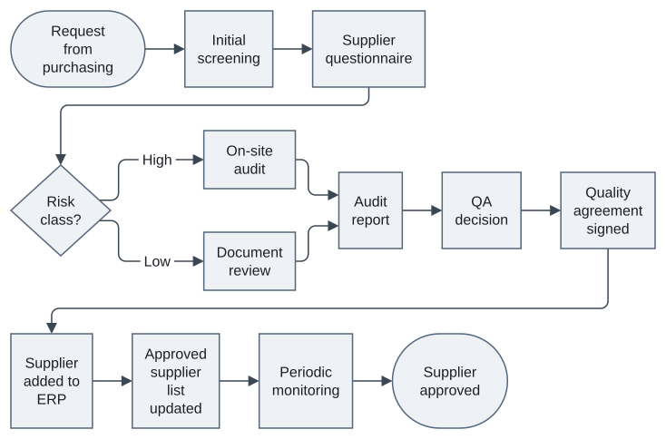
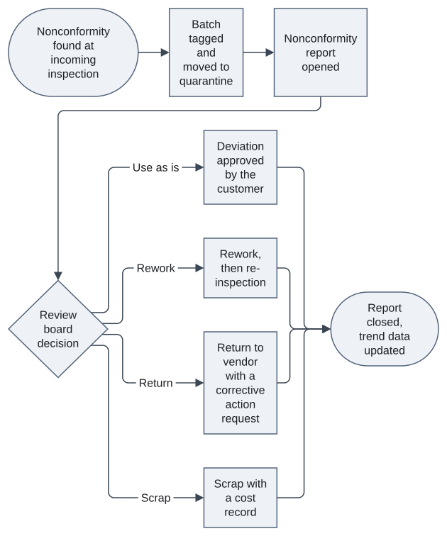
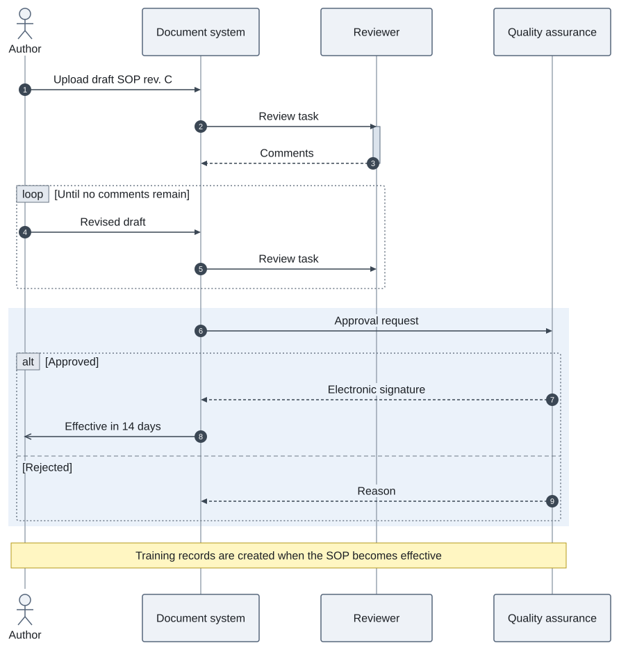

# gomermaidgo

Renders diagrams written in Mermaid syntax to SVG (and optionally PDF and PNG) in pure Go: no JavaScript, no browser, no dependencies outside the
Go standard library. The same source and options always give the same SVG, byte for byte.

```go
import "github.com/polestorm/gomermaidgo/mermaid"

svg, err := mermaid.Render(source)
```

## Why gomermaidgo

Compared with two other Go renderers that need no browser, [`mmdg`](https://github.com/bvolpato/mermaid-go-renderer)
and [`go-mermaid`](https://github.com/zkrebbekx/go-mermaid) (details in [Comparison](#comparison)):

- **Smallest footprint**: a single 8.4 MB program with no dependencies at all, PDF and PNG included.
- **The fastest of the three**: SVG, PDF and PNG creation takes 35–90% less time than with the others.
- **Printing friendly**: narrows fields, folds long processes/chains, staggers long ranks, to fit A4 pages.
- **Small output**: plain SVG 1.1 without embedded fonts or CSS, much smaller than mmdg's and a little smaller than
  go-mermaid's; PDF with real, searchable text.
- **Made for documents**: a neutral look that prints well in black and white, Markdown documents with embedded
  diagrams, and the flags of `mermaid-cli`.

## Contents

- [Why gomermaidgo](#why-gomermaidgo) · [Comparison](#comparison) · [Examples](#examples) ·
  [Diagram types](#diagram-types) · [Documentation](#documentation) ·
  [How the comparison was measured](#how-the-comparison-was-measured) · [License](#license)
- [Usage](docs/usage.md): fonts, colours and themes, fitting to A4, PDF, PNG, command line, Markdown
- [Gallery](docs/gallery/README.md): [page fitting](docs/gallery/page-fitting.md),
  [all diagram types](docs/gallery/types.md), [scripts and symbols](docs/gallery/scripts.md)
- [Supported syntax](docs/profile.md)

## Comparison

Compared with two other Go programs that need no browser: [`mmdg`](https://github.com/bvolpato/mermaid-go-renderer)[^ref],
which runs Mermaid itself in an embedded JavaScript engine, and [`go-mermaid`](https://github.com/zkrebbekx/go-mermaid),
which, like this library, has its own parsers and layout.

| | gomermaidgo | mmdg 0.14.1 | go-mermaid 0.1.6 |
|---|:---:|:---:|:---:|
| Approach | own parsers and layout in Go | Mermaid 12.2.0 (embedded JavaScript) | own parsers and layout in Go |
| Dependencies[^deps] | 0 🥇 | 7 | 5 |
| Program size | 8.4 MB 🥇 | 53.0 MB | 11.7 MB |
| SVG time[^bench] | 3.1 ms 🥇 | 31 ms | 4.9 ms |
| SVG memory | 7 MB 🥇 | 40 MB | 12 MB |
| PDF time | 4.4 ms 🥇 | 32 ms | no PDF |
| PDF memory | 15 MB 🥇 | 54 MB | no PDF |
| PNG time | 13 ms 🥇 | 39 ms | 27 ms |
| PNG memory | 18 MB | 43 MB | 17 MB 🥇 |
| SVG output[^size] | 0.19 MB 🥇 | 11.8 MB | 0.20 MB |
| PNG output | 2.4 MB | 2.1 MB | 1.9 MB 🥇 |
| PDF output | 1.7 MB 🥇 | 13.0 MB | no PDF |
| Diagram types[^types] | 33 of Mermaid's 33 🥇 | 33 🥇 | 20 |
| Syntax coverage | a documented profile; anything outside it is an error with a line number | everything Mermaid accepts | a documented subset per type |
| Public diagrams[^wild] | 138 of 139 | 137 of 139 | 123 of 139 |
| Look | own, made for print; neutral by default | Mermaid's, byte for byte | own; Mermaid's theme names |
| Page fitting | fit to A4, folding of long diagrams, chains and ranks | none | none |
| SVG content | basic SVG 1.1 elements, no CSS, no scripts, no `foreignObject`; role classes on request | Mermaid's SVG with CSS and embedded fonts | basic SVG elements, no CSS, no scripts, no `foreignObject` |
| PDF and PNG | own writers, real text in PDF, optional (build tags) | yes | PNG (separate package) |
| Markdown documents | yes (`markdown.Embed`, CLI) | yes (CLI) | no |
| `mermaid-cli` flags | yes | yes | own flags |
| Deterministic output[^det] | yes, documented | yes, in our runs | yes, in our runs |
| License | Apache 2.0 | MIT | MIT |
| GitHub popularity[^pop] | new | 5 stars, 1 fork | 13 stars, 5 forks 🥇 |

Every number in this table can be measured again from a fresh clone: the inputs are in the repository or pinned by
checksum, and the commands, method and raw results are in [`docs/benchmarks.md`](docs/benchmarks.md#repeating-the-run).

[^ref]: `mmdg` is the reference renderer this library is compared with throughout its tests and reviews.
[^deps]: Go modules linked into the program (`dep` lines of `go version -m`); program size as built by `go build`.
[^bench]: Time and memory per diagram, PNG at scale 1. Median over the corpus diagrams all compared programs rendered
    (63 for SVG and PNG; 87 for PDF, which go-mermaid does not write), best of three runs of the command-line program
    per file, process start included; memory is the peak resident size. Measured on 2026-11-26 on an Apple M4 laptop
    with `tools/bench`; inputs, commands and raw results are in [`docs/benchmarks.md`](docs/benchmarks.md).
    🥇 marks the best value in a row.
[^det]: The same source gives the same file byte for byte on every run. Here it is documented (see the top of this
    page) and tested; for the other two, the three timed runs of every file gave identical SVG, PNG and PDF files
    ([method](docs/benchmarks.md#what-the-numbers-mean)), but neither documents it.
[^size]: Total size of the files written for the same diagrams: 63 for SVG and PNG, 87 for PDF.
[^pop]: Stars and forks on 2026-11-23.
[^types]: Mermaid 12.2 recognises 33 diagram types, `zenuml` among them as a separate add-on; all of them are drawn
    here. go-mermaid lists 20 types (`-list-types`); of those drawn here it lacks `architecture-beta`,
    `treemap-beta`, `ishikawa-beta`, `swimlane-beta`, `treeView-beta`, `venn-beta`, `cynefin-beta`,
    `usecase-beta`, `zenuml`, `wardley-beta`, `eventmodeling`, `agentflow` and the `railroad` diagrams.
[^wild]: 168 blocks marked `mermaid` in public GitHub repositories, pinned to commits in
    [`testdata/wild/sources.tsv`](testdata/wild/sources.tsv) and fetched by `go run ./tools/wildcorpus`; 29 are
    rejected by all three programs (fragments without a diagram header, or not Mermaid at all), which leaves 139.

## Examples

A 13-step process written left to right. Mermaid draws it as one strip, 16 times wider than tall; this library
folds it into rows by default, so it fits an A4 page at about four times the scale:



<table>
<tr>
<td width="50%"></td>
<td width="50%"></td>
</tr>
<tr>
<td>Long labels and a wide branching: fields are narrowed (text wraps more often) and the diagram is folded,
from 1770 × 404 to 631 × 756.</td>
<td>A sequence diagram with numbering, a loop, alternatives, a highlighted block and a note.</td>
</tr>
</table>

More in the [gallery](docs/gallery/README.md): [page fitting](docs/gallery/page-fitting.md) with and without each
option, [all 33 diagram types](docs/gallery/types.md), and [scripts and symbols](docs/gallery/scripts.md).

## Diagram types

Status: early. Drawn: `flowchart`/`graph`, `sequenceDiagram`, `classDiagram`, `stateDiagram-v2`, `erDiagram`,
`gantt`, `pie`, `journey`, `gitGraph`, `mindmap`, `timeline`, `quadrantChart`, `xychart-beta`, `sankey-beta`,
`requirementDiagram`, C4 diagrams, `block-beta`, `packet-beta`, `kanban`, `architecture-beta`, `radar-beta`,
`treemap-beta`, `ishikawa-beta`, `swimlane-beta`, `treeView-beta`, `venn-beta`, `cynefin-beta`, `usecase-beta`, `zenuml`, `wardley-beta`, `eventmodeling`, `agentflow` and the `railroad` diagrams; one example of each is in the
[gallery](docs/gallery/types.md). Graphs use a layered layout written from the published algorithms. The supported
syntax and its current limits are listed in [`docs/profile.md`](docs/profile.md); a construct outside it is an error
with a line number, never a partial drawing.

## Documentation

- [`docs/usage.md`](docs/usage.md): how to use the library and the command.
- [`docs/gallery/`](docs/gallery/README.md): pictures with their sources.
- [`docs/profile.md`](docs/profile.md): supported syntax and its limits.
- [`docs/benchmarks.md`](docs/benchmarks.md): how the comparison is measured and how to repeat it.
- In Polish: [`docs/provenance.md`](docs/provenance.md)
  (sources and clean-room rules), [`docs/testing.md`](docs/testing.md) (corpus, invariants, comparison with
  reference renderers), [`requirements/`](requirements/) (numbered requirements), [`docs/adr/`](docs/adr/)
  (decisions).

## How the comparison was measured

The full method, the inputs and the commands to repeat every number are in
[`docs/benchmarks.md`](docs/benchmarks.md). In short: all three programs read the same corpus sources (`testdata/corpus/`); for the comparison the other renderers are only
run as programs (what was ever read of them is listed in `docs/provenance.md`). Times and memory come from the
command-line programs, so they include process start; for `mmdg` that includes starting its JavaScript engine. PNG is compared at scale 1 (one image pixel
per drawing pixel); this library's default is scale 2. A diagram counts as rendered when the program exits without an
error and writes a non-empty file; how well it is drawn is not compared here. Times and sizes use only the corpus
diagrams all compared programs render; the corpus itself is written for this library's profile, so how many of its
diagrams each program renders is not a fair measure and is not shown. Coverage is compared on public diagrams
instead: `go-mermaid` rejects the diagram types it does not draw and constructs outside its syntax (for example newer
flowchart shapes, sequence participant groups, gantt excludes); the one public diagram this library rejects uses
`subgraph` inside a state diagram.

## License

Apache License 2.0, see `LICENSE` and `NOTICE`. The bundled Arimo and Noto Emoji typefaces are distributed under the
SIL Open Font License 1.1 (`fonts/OFL-Arimo.txt`, `fonts/OFL-NotoEmoji.txt`).
