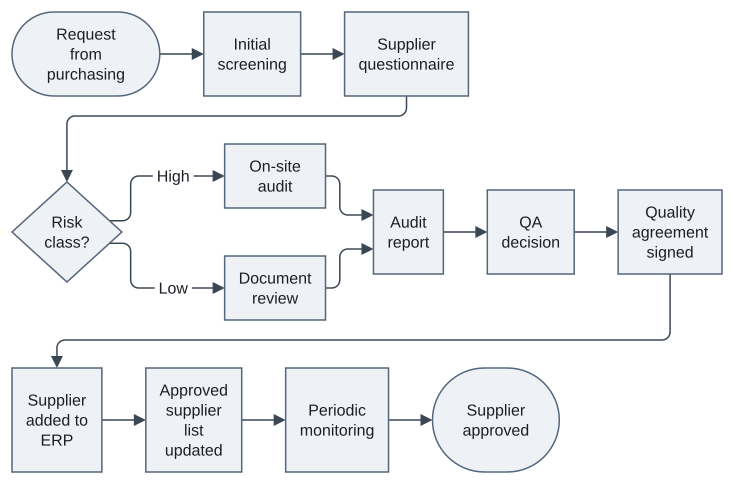
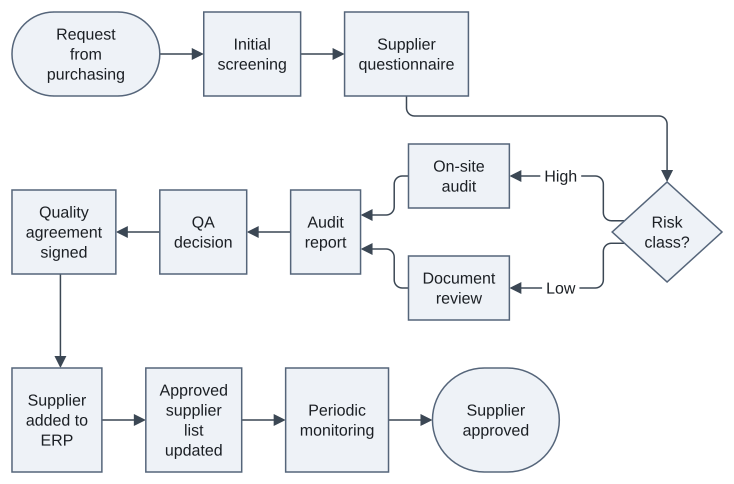
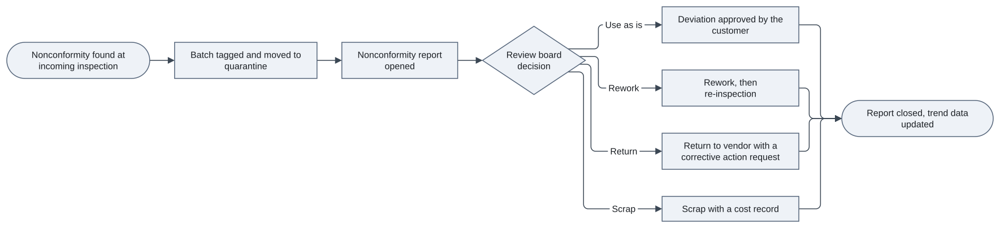
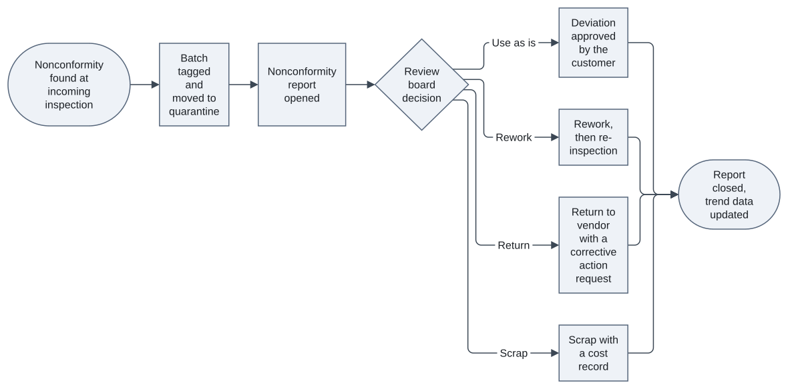
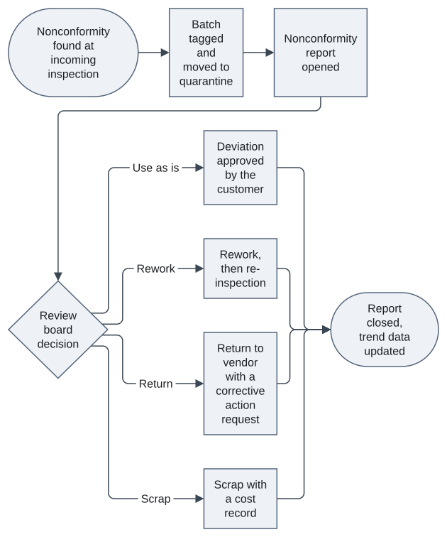
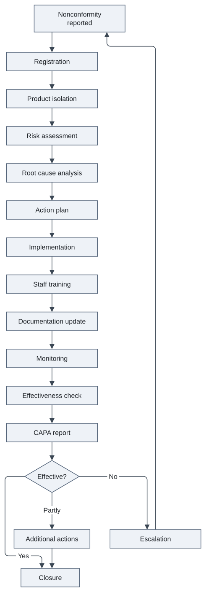
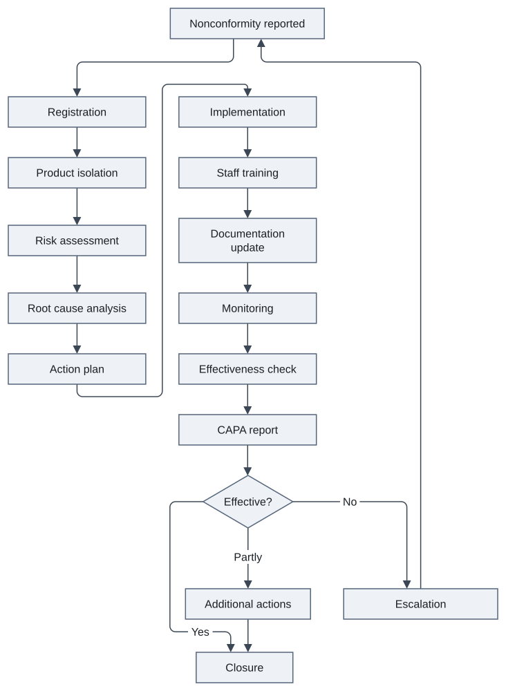
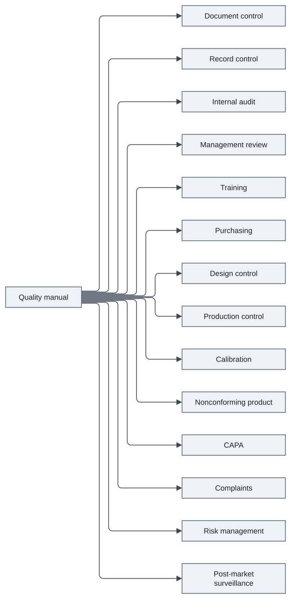
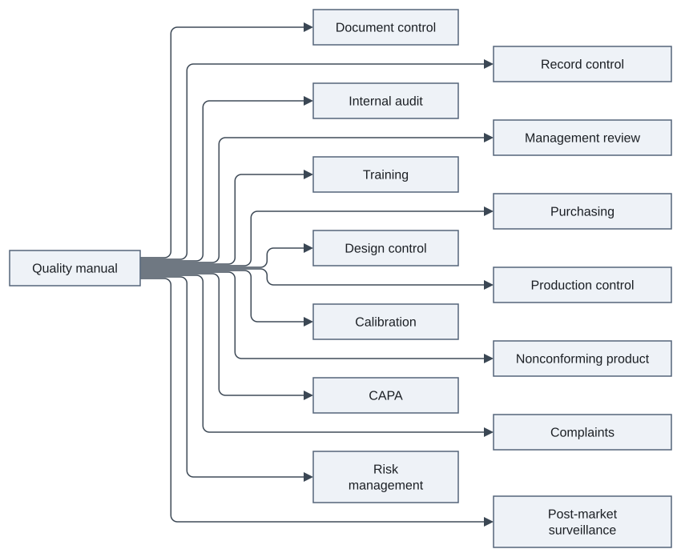

# Page fitting

Mermaid lays a diagram out in one long row or column, whatever its length. A printed page is not that shape:
a long process drawn left to right becomes a strip that a page can only show at a fraction of its size. This
library can lay such a diagram out again so that it fits an A4 page at a larger scale. Fitting and folding of
whole diagrams are on by default (`auto`) and act only on drawings that need them; folding of chains and
ranks inside a diagram is off by default and is switched on per diagram or per call.

| Option | Default | In the source | Go | Command line |
|---|---|---|---|---|
| Fit: narrower fields, more text wrapping | `auto` | `%% layout: fit` / `nofit` | `WithFit` | `-fit` |
| Fold a long diagram into rows or columns | `auto` | `%% layout: fold` / `nofold` | `WithFold` | `-fold` |
| How folded rows continue | `return` | `%% layout: fold snake` | `WithFoldType` | `-fold-type` |
| Fold a long chain inside a diagram | `off` | `%% layout: fold-chains` | `WithFoldChains` | `-fold-chains` |
| Stagger a long rank of leaves | `off` | `%% layout: fold-ranks` | `WithFoldRanks` | `-fold-ranks` |

Sizes below are in drawing pixels (width × height).

## Folding a long diagram into rows

A supplier approval process of 13 steps, [`src/fold.mmd`](src/fold.mmd), drawn left to right.

Without folding (`-fold off`): 2850 × 180, almost 16 times wider than tall.

Folded (the default): 735 × 484. Each row continues from the left, joined by a connector.

Folded as a snake (`%% layout: fold snake`, `-fold-type snake`): every other row runs the other way.

## Fitting: narrower fields

A nonconforming product process with long labels, [`src/fit.mmd`](src/fit.mmd).

Without fitting and folding: 1770 × 404.

Fitted, without folding (`-fit on -fold off`): fields are narrower and the text wraps more often, 1181 × 584.

Fitted and folded (the default): 631 × 756, close to the proportions of a page.

## Folding a long chain inside a diagram

A CAPA process whose eleven steps from registration to the report form one chain between a start, a decision
and a loop back, [`src/fold-chains.mmd`](src/fold-chains.mmd). The whole diagram cannot be folded (it is not one
simple path), but the chain can.

Without (`-fold-chains off`): 509 × 1404.

With `%% layout: fold-chains`: the chain stands in two columns, 733 × 1000.

## Staggering a long rank

A quality manual with 14 procedures, [`src/fold-ranks.mmd`](src/fold-ranks.mmd): all 14 stand in one rank.

Without (`-fold-ranks off`): 625 × 1284.

With `%% layout: fold-ranks`: every other procedure moves one rank further, 850 × 696. The order stays as in
the source and no edge crosses another.

