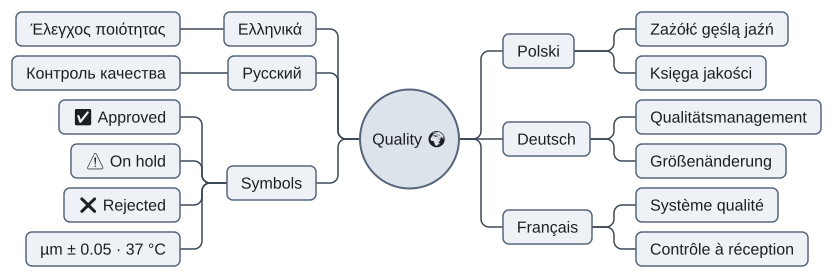
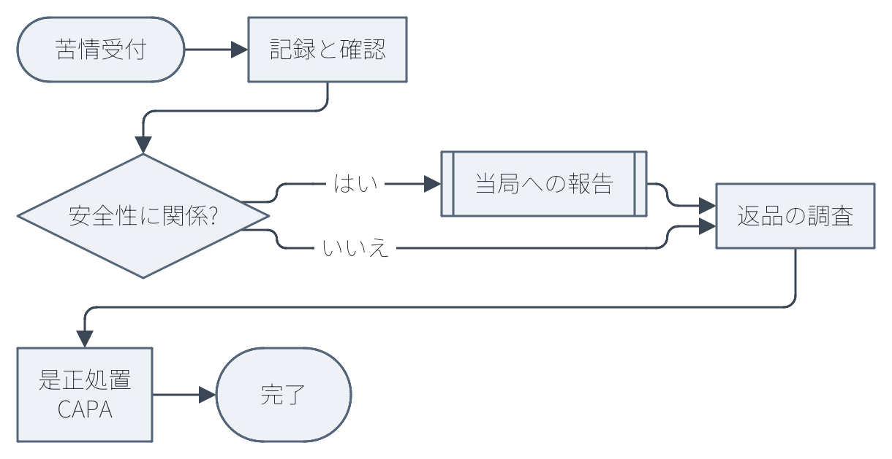

# Scripts and symbols

Text is measured with the font that will draw it, so labels in any script fit their boxes. The bundled Arimo
typeface covers Latin, Greek and Cyrillic; emoji and symbols it lacks come from the bundled Noto Emoji and are
written to the SVG as outlines, so they look the same everywhere. Source:
[`src/scripts/multilingual.mmd`](src/scripts/multilingual.mmd).

## Japanese, Chinese, Korean

Arimo has no CJK glyphs. Give the library a TrueType font that has them (`WithFont`, `-font`) and the same
diagram is laid out with that font. The picture below is the PNG writer's output with Noto Sans JP (SIL Open
Font License 1.1); the font is not part of this module. Source: [`src/scripts/japanese.mmd`](src/scripts/japanese.mmd).

Current limits: one text font per drawing (no fallback from one text font to another, so a label that mixes
Japanese with Polish needs a font that has both), TrueType outlines only (`glyf`; fonts with CFF outlines and
font collections are not read), and no right-to-left scripts.
