# Diagram types

One diagram of each type this library draws, in its default neutral look (`WithColors` adds colour).
Each section links the Mermaid source of its picture.

[Flowchart](#flowchart) · [Sequence diagram](#sequence-diagram) · [Class diagram](#class-diagram) · [State diagram](#state-diagram) · [Entity relationship diagram](#entity-relationship-diagram) · [Gantt chart](#gantt-chart) · [Pie chart](#pie-chart) · [User journey](#user-journey) · [Git graph](#git-graph) · [Mind map](#mind-map) · [Timeline](#timeline) · [Quadrant chart](#quadrant-chart) · [XY chart](#xy-chart) · [Sankey diagram](#sankey-diagram) · [Requirement diagram](#requirement-diagram) · [C4 diagram](#c4-diagram) · [Block diagram](#block-diagram) · [Packet diagram](#packet-diagram) · [Kanban board](#kanban-board) · [Architecture diagram](#architecture-diagram) · [Radar chart](#radar-chart) · [Treemap](#treemap) · [Ishikawa (cause and effect) diagram](#ishikawa-cause-and-effect-diagram) · [Swimlane diagram](#swimlane-diagram) · [Tree view](#tree-view)

## Flowchart

`flowchart`, source: [`src/types/01-flowchart.mmd`](src/types/01-flowchart.mmd)

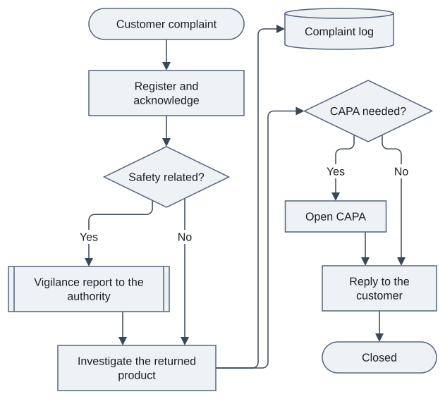

## Sequence diagram

`sequenceDiagram`, source: [`src/types/02-sequence.mmd`](src/types/02-sequence.mmd)

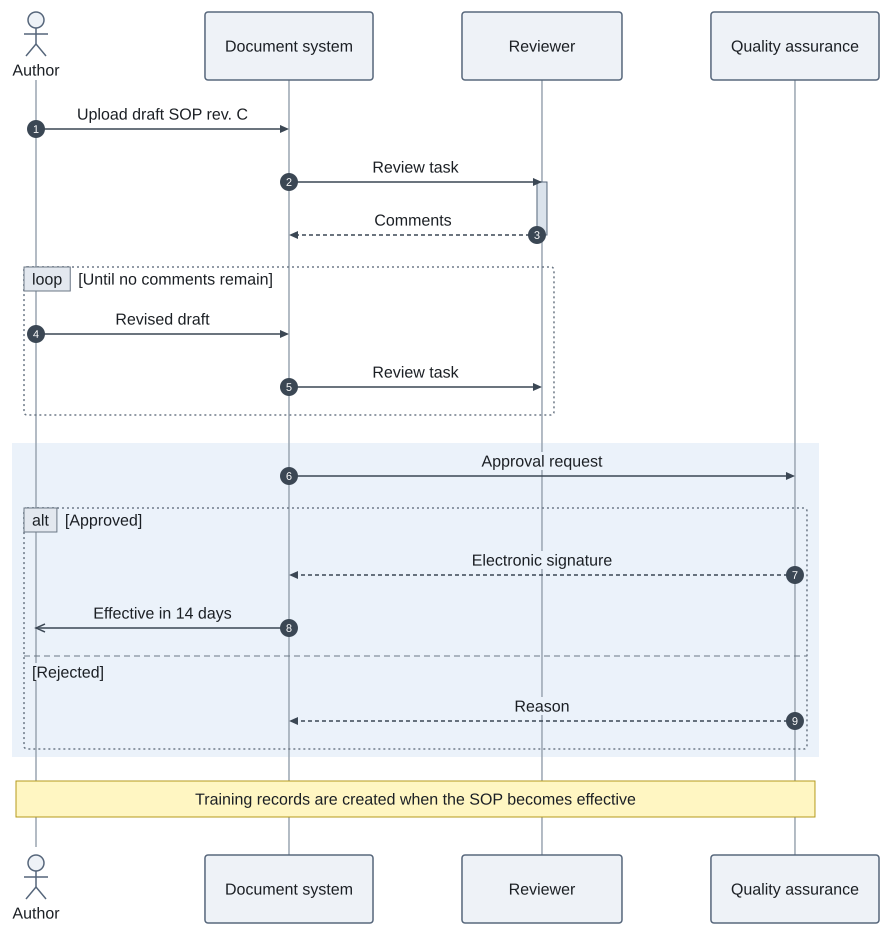

## Class diagram

`classDiagram`, source: [`src/types/03-class.mmd`](src/types/03-class.mmd)

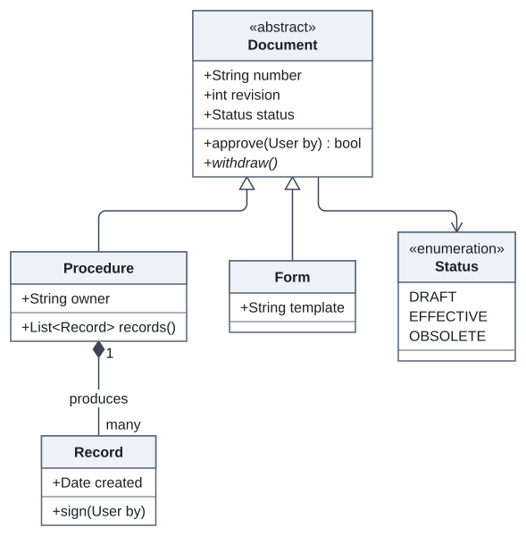

## State diagram

`stateDiagram-v2`, source: [`src/types/04-state.mmd`](src/types/04-state.mmd)

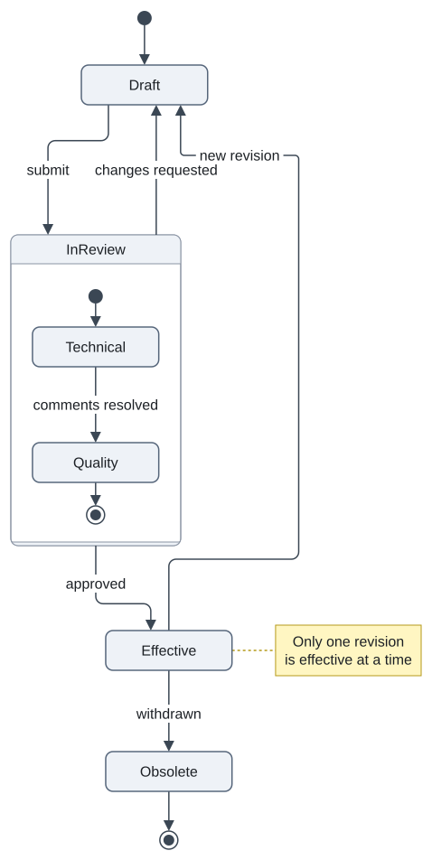

## Entity relationship diagram

`erDiagram`, source: [`src/types/05-er.mmd`](src/types/05-er.mmd)

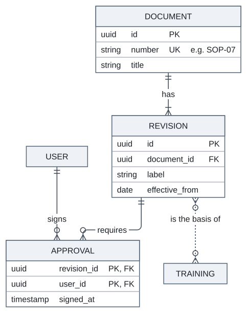

## Gantt chart

`gantt`, source: [`src/types/06-gantt.mmd`](src/types/06-gantt.mmd)

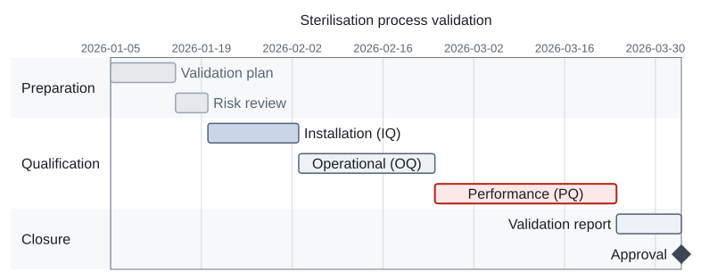

## Pie chart

`pie`, source: [`src/types/07-pie.mmd`](src/types/07-pie.mmd)

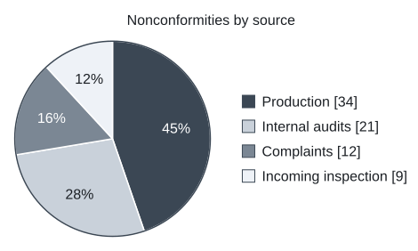

## User journey

`journey`, source: [`src/types/08-journey.mmd`](src/types/08-journey.mmd)

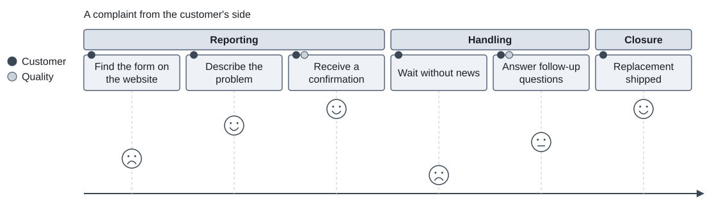

## Git graph

`gitGraph`, source: [`src/types/09-gitgraph.mmd`](src/types/09-gitgraph.mmd)

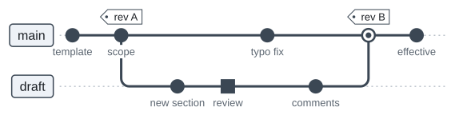

## Mind map

`mindmap`, source: [`src/types/10-mindmap.mmd`](src/types/10-mindmap.mmd)

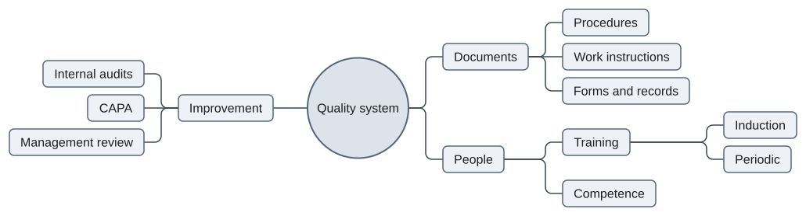

## Timeline

`timeline`, source: [`src/types/11-timeline.mmd`](src/types/11-timeline.mmd)

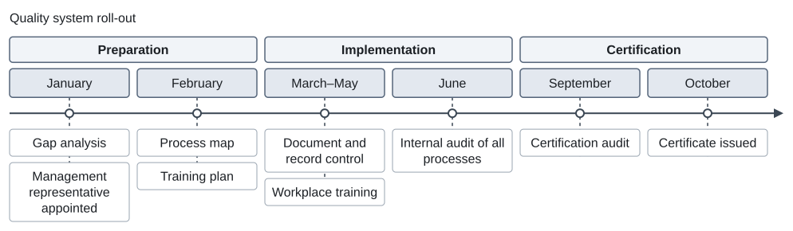

## Quadrant chart

`quadrantChart`, source: [`src/types/12-quadrant.mmd`](src/types/12-quadrant.mmd)

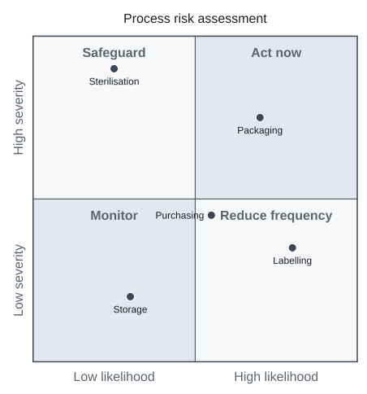

## XY chart

`xychart-beta`, source: [`src/types/13-xychart.mmd`](src/types/13-xychart.mmd)

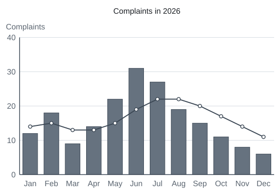

## Sankey diagram

`sankey-beta`, source: [`src/types/14-sankey.mmd`](src/types/14-sankey.mmd)

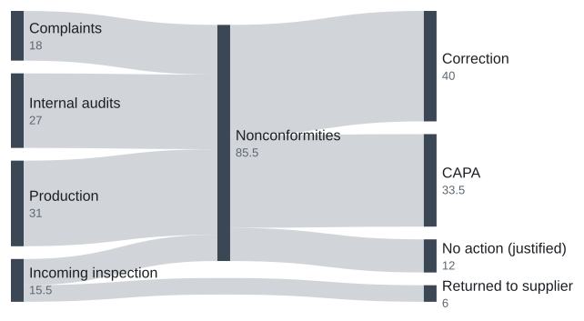

## Requirement diagram

`requirementDiagram`, source: [`src/types/15-requirement.mmd`](src/types/15-requirement.mmd)

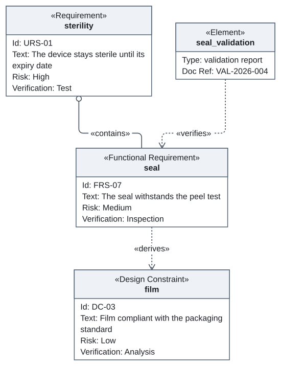

## C4 diagram

`C4Context`, source: [`src/types/16-c4.mmd`](src/types/16-c4.mmd)

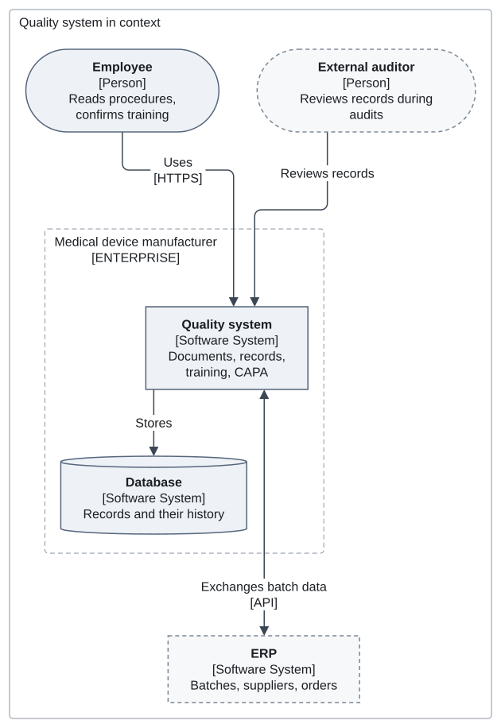

## Block diagram

`block-beta`, source: [`src/types/17-block.mmd`](src/types/17-block.mmd)

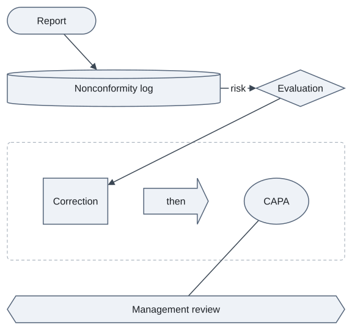

## Packet diagram

`packet-beta`, source: [`src/types/18-packet.mmd`](src/types/18-packet.mmd)

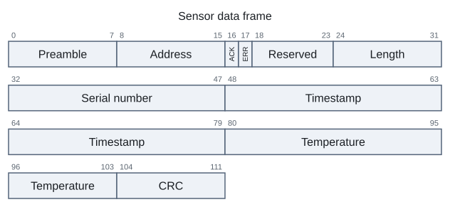

## Kanban board

`kanban`, source: [`src/types/19-kanban.mmd`](src/types/19-kanban.mmd)

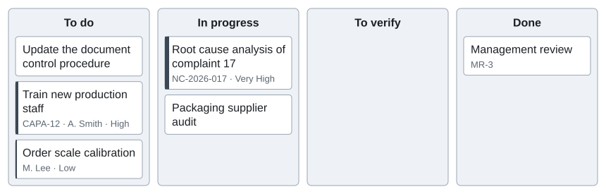

## Architecture diagram

`architecture-beta`, source: [`src/types/20-architecture.mmd`](src/types/20-architecture.mmd)

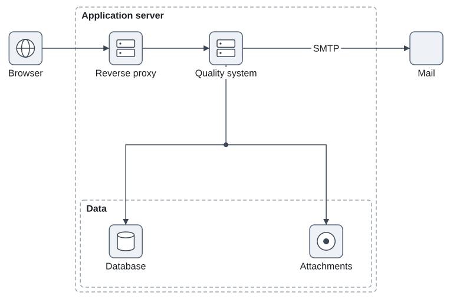

## Radar chart

`radar-beta`, source: [`src/types/21-radar.mmd`](src/types/21-radar.mmd)

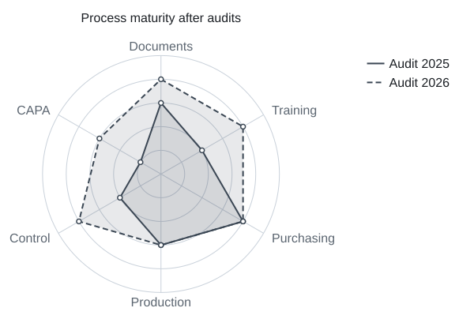

## Treemap

`treemap-beta`, source: [`src/types/22-treemap.mmd`](src/types/22-treemap.mmd)

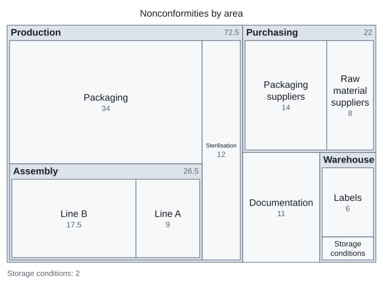

## Ishikawa (cause and effect) diagram

`ishikawa-beta`, source: [`src/types/23-ishikawa.mmd`](src/types/23-ishikawa.mmd)

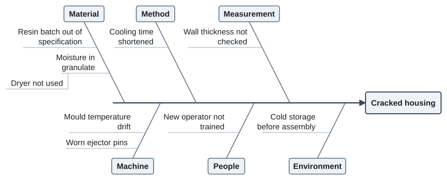

## Swimlane diagram

`swimlane-beta`, source: [`src/types/24-swimlane.mmd`](src/types/24-swimlane.mmd)

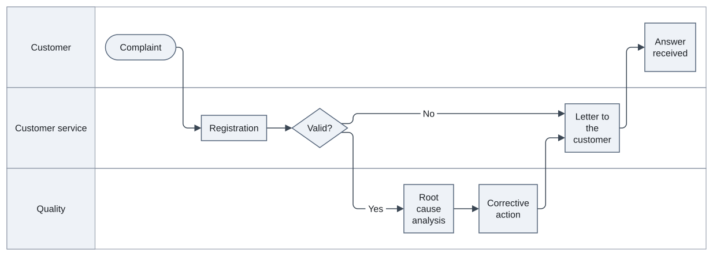

## Tree view

`treeView-beta`, source: [`src/types/25-treeview.mmd`](src/types/25-treeview.mmd)

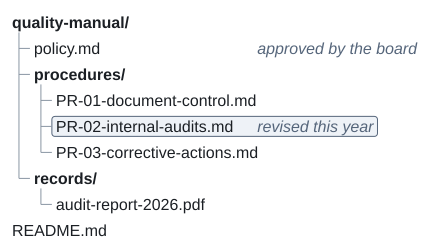
